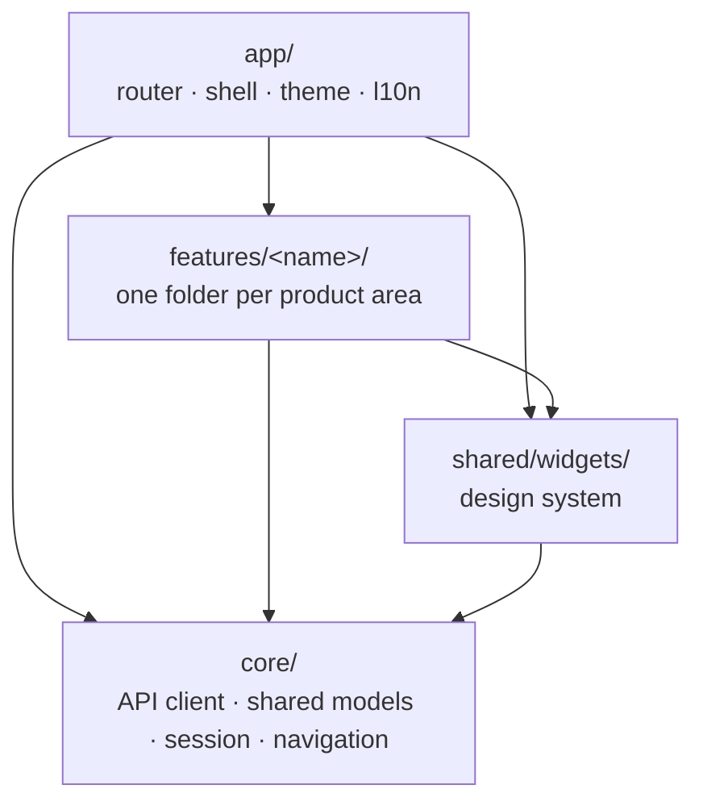
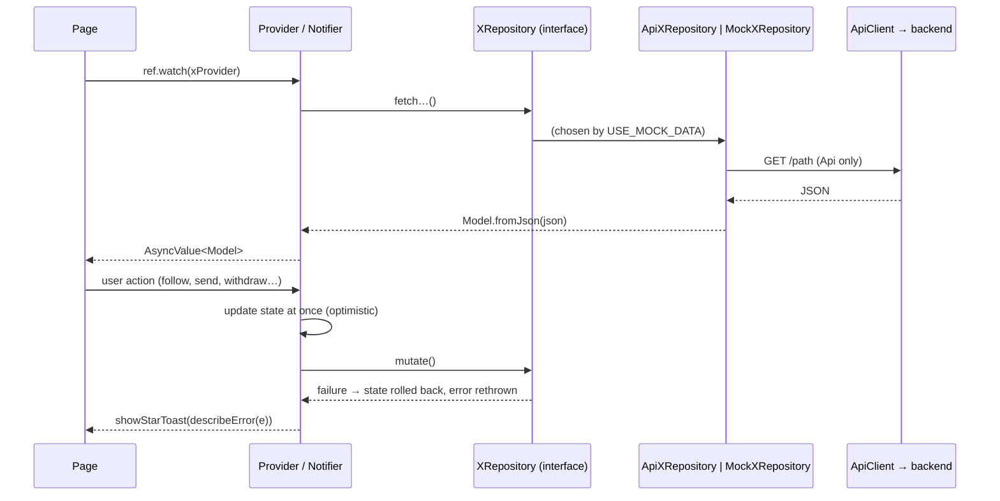
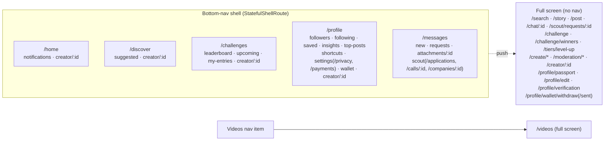

# Star App: architecture structure

Where everything lives and how the pieces connect. For the rules behind it (data layer, errors, navigation constraints, what's left before launch) see [ARCHITECTURE.md](ARCHITECTURE.md).

## Repository layout

```
starapp/
├── lib/                 app source (below)
├── test/                unit, widget and router tests (mirrors lib/)
├── assets/
│   ├── fonts/           Inter (Light–ExtraBold)
│   ├── images/<feature>/  bitmaps; mock content photos live here too
│   └── vectors/<feature>/ SVG icons and illustrations (shared/ for common ones)
├── docs/                ARCHITECTURE.md, ARCHITECTURE_STRUCTURE.md
├── android/ ios/ web/   platform projects
├── pubspec.yaml         dependencies and asset folders
└── l10n.yaml            localization generation (ARB files in lib/app/localization)
```

## The four layers of `lib/`



**Who may import whom**, following the arrows only:

| Layer | May import | Never imports |
|---|---|---|
| `app/` | everything | — |
| `features/<x>/` | `core/`, `shared/`, its own files | another feature |
| `shared/` | `core/` | `app/`, features |
| `core/` | Flutter and packages only | `app/`, `shared/`, features |

Features reach each other only through routes (`AppRoutes`) and the shared state in `core/`. Removing or rewriting a feature therefore never breaks another.

## `lib/app/`: composition

| Path | Holds |
|---|---|
| `router/app_router.dart` | `createAppRouter()`: every route, the tab shell and the full-screen routes |
| `shell/main_shell.dart` | `MainShell`: the floating bottom nav, the tab ↔ branch mapping and the Messages unread dot |
| `theme/app_theme.dart` | `AppTheme.light` and the `AppColors` tokens |
| `localization/` | ARB files and the generated `AppLocalizations` |
| `providers/locale_provider.dart` | the selected language |

`lib/main.dart` starts the app inside a `ProviderScope`. It also sends the user to sign-in when the session expires (`sessionExpiredProvider`).

## `lib/core/`: shared foundation

```
core/
├── config/app_config.dart        API base URL and mock switch (--dart-define)
├── constants/app_routes.dart     every route path (the only way features link)
├── network/
│   ├── api_client.dart           Dio wrapper: auth header, errors → ApiException,
│   │                             selectRepository(), sessionExpiredProvider
│   ├── api_exception.dart        typed failures + describeError()
│   ├── paged.dart                Paged<T> {items, nextCursor}
│   └── token_store.dart          secure access-token storage
├── models/                       entities used by more than one feature
│   ├── creator_summary.dart      a person in any list
│   ├── creator_tier.dart         Shooting Star → Universe Icon
│   ├── money.dart                Money (minor units) + Currency
│   ├── company_summary.dart      a verified company in any list
│   └── attachment.dart           a shared file
├── session/                      the signed-in user, built like a feature
│   └── data/{models,repositories,provider}
│       currentUserProvider · followingProvider · sign-out
├── navigation/
│   ├── creator_navigation.dart   context.pushCreator(id)
│   └── tab_navigation.dart       context.pushInTab(path)
└── utils/
    ├── json.dart                 tolerant fromJson helpers
    └── formatters.dart           48K, 1,940, "2h ago", ₦1,240,500, 1:15
```

## `lib/shared/widgets/`: design system

| File | Widgets |
|---|---|
| `star_image.dart` | `StarImage`, `StarAvatar`, `starImageProvider`: every content image (URL or asset) |
| `star_tabs.dart` | `StarTabBar`, `StarChoiceChips`, `StarPill`: every tab bar and filter row |
| `star_async_view.dart` | `StarAsyncView`: loading, error (with retry) and data for any `AsyncValue` |
| `star_bottom_sheet.dart` | `StarSheet`, `showStarSheet` |
| `star_toast.dart` | `showStarToast`: all feedback (no SnackBars) |
| `star_share_sheet.dart` | `showStarShareSheet` (WhatsApp, X, system share, copy link) |
| `log_out_sheet.dart` | `showLogOutSheet` |
| `star_bottom_nav.dart` | `StarBottomNav` (used by `MainShell`) |
| `star_screen_header.dart`, `star_icon_button.dart`, `star_buttons.dart`, `star_bottom_bar.dart` | headers, icon buttons, primary/outlined buttons, sticky bottom bars |
| `star_form_fields.dart`, `star_radio_card.dart`, `star_media_summary_card.dart`, `star_success_hero.dart` | form and content building blocks |
| `auth_buttons.dart`, `shared_icons.dart` | auth buttons, shared icon paths |
| `app_button.dart` | `AppButton`, currently unused |

## Anatomy of a feature

Every feature has the same shape. `features/notifications` is the smallest complete example:

```
features/notifications/
├── data/
│   ├── models/
│   │   └── app_notification.dart            immutable model + fromJson/toJson
│   ├── repositories/
│   │   ├── notifications_repository.dart     abstract interface (the contract)
│   │   ├── api_notifications_repository.dart REST implementation (ApiClient)
│   │   └── mock_notifications_repository.dart JSON fixtures → fromJson
│   └── provider/
│       └── notifications_providers.dart      repository provider + state notifiers
└── presentation/
    ├── pages/
    │   └── notifications_page.dart           one page per route
    └── widgets/
        └── notification_card.dart            pieces used by the pages
```

| Folder | Contains | Rules |
|---|---|---|
| `data/models` | what the API returns | raw values only (int, `DateTime`, `Money`, `…Url`), `fromJson`/`toJson` |
| `data/repositories` | interface + `api_` + `mock_` | screens never call these directly |
| `data/provider` | Riverpod providers, written by hand | `selectRepository(ref, mock:, api:)` picks the implementation |
| `presentation/pages` | `ConsumerWidget`/`ConsumerStatefulWidget` pages | render through `StarAsyncView`; format values here |
| `presentation/widgets` | the feature's private widgets and style constants | reuse `shared/` first |

## Data flow



## Features

| Feature | Screens | Data (repositories) |
|---|---|---|
| `splash`, `onboarding` | splash, onboarding carousel | onboarding |
| `auth` | welcome, sign in/up, OTP, forgot/new password, language, registration steps (password, photo, interests, welcome challenge, notifications) | auth (stores the access token) |
| `home` | home feed (Home tab root) | home |
| `stories` | story viewer, story create | stories |
| `notifications` | notifications | notifications |
| `discover` | discover (Discover tab root), suggested creators | discover |
| `search` | search | search |
| `videos` | full-screen video feed (For You / Following, comments) | videos |
| `challenges` | hub (Challenges tab root), leaderboard, upcoming, my entries, challenge detail, winners, tier level-up | challenges |
| `create` | camera, preview & edit, submit entry, uploading, entry submitted | create (uploads) |
| `moderation` | content paused, appeal, appeal submitted | moderation |
| `profile` | my profile (Profile tab root), shortcuts, star insights, top posts, talent passport, saved, followers/following, creator profile, my post | my_profile, insights, my_post, saved, creator, connections |
| `settings` | settings, privacy & security, edit profile | settings |
| `verification` | creator verification, submitted | verification |
| `messages` | inbox (Messages tab root), new message, conversation, attachment viewer | messages (polls for live updates) |
| `scout` | marketplace, open call, my applications, company, scout requests, scout request | scout |
| `wallet` | wallet, withdraw, withdrawal sent, activity, transaction, statements, payouts, add payout method, tax info | wallet |

## Navigation map



- **Tabs and the nav bar.**
  - The nav items are Home, Discover, Challenges, Videos (opens the full-screen feed), Messages and Profile.
  - Pages pushed inside a tab keep the nav bar.
  - The full-screen routes cover it.
- **Mirrors.** Some tab pages can also be opened from full-screen pages, so they are registered twice: in the tab and at the top level.
  - The mirrored pages are a creator profile, an open call, a company, an attachment, New Message and payouts.
  - Link to them with `context.pushCreator(id)` or `context.pushInTab(AppRoutes.x)`.
- **Constants.** Every path is a constant or function in `lib/core/constants/app_routes.dart`; never hard-code a path.

## Tests

```
test/
├── app/
│   ├── shell_navigation_test.dart   real router: every route renders, tab stacks,
│   │                                full-screen pages, mirrors, cross-feature flows
│   └── auth_flow_test.dart          registration and password-reset flows
└── features/<feature>/
    ├── <feature>_models_test.dart   fixtures parse and cover the designed states,
    │                                toJson → fromJson round-trips, rollback
    └── <feature>_pages_test.dart    key interactions (where present)
```

## Adding a feature

1. **Folders.** Create `lib/features/<name>/` with the `data/` and `presentation/` folders shown above.
2. **Models** in `data/models`: raw API values and `fromJson`/`toJson`. Reuse `core/models` for people, companies, money and files.
3. **Repositories:** write the interface, then the `api_` implementation with the REST paths, then the `mock_` implementation. The mock's fixtures double as the API contract.
4. **Providers** in `data/provider`, with `selectRepository(ref, mock: …, api: …)`.
5. **Pages and widgets** built from `shared/widgets`: `StarAsyncView`, `StarTabBar`/`StarChoiceChips`, `StarImage`, `showStarToast`, and so on.
6. **Routes:** add the paths to `AppRoutes` and register them in `app/router/app_router.dart`, either inside a tab branch or as a full-screen route.
7. **Assets** go in `assets/images/<name>/` and `assets/vectors/<name>/`. Register both folders in `pubspec.yaml`.
8. **Tests:** add `test/features/<name>/` with model tests, and add the routes to `test/app/shell_navigation_test.dart`.

## Naming

| Thing | Convention | Example |
|---|---|---|
| Files | `snake_case.dart` | `scout_request_page.dart` |
| Pages | `<Name>Page` in `presentation/pages` | `ScoutRequestPage` |
| Repositories | `XRepository`, `ApiXRepository`, `MockXRepository` | `WalletRepository` |
| Providers | `xRepositoryProvider`, `xProvider`, `xProvider(id)` | `walletSummaryProvider` |
| Image fields | `…Url` | `avatarUrl`, `posterUrl` |
| JSON keys | camelCase, matching the field names | `"nextCursor"` |
| Assets | `assets/<images\|vectors>/<feature>/`, named for what they show | `vectors/wallet/ic_arrow_up_right_navy.svg` |
| Branches | `feature/<name>` from `main` → `develop` → `main` | `feature/help-centre` |
